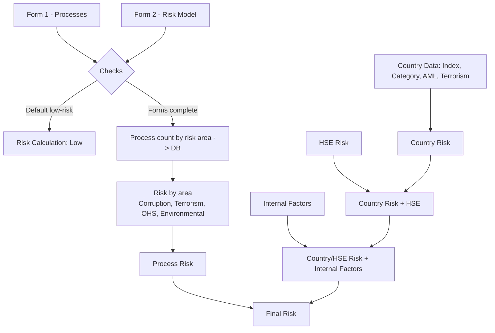

# Group Company Risk Classification (VBA / Excel)

A VBA macro that assigns each company within a group a **Low / Medium / High** risk rating, based on two Excel questionnaires (activities performed and outsourced processes), together with country risk and HSE indicators.

> ⚠️ This repository contains **code only**. It does not include real data: no company or client names, and no assessment results. Company names are retrieved from the questionnaire cells at runtime.

---

## What It Does

The `Salva` macro:

1. **Checks** that the company name is entered in both questionnaires, matches exactly, and is included in the company-country mapping.
2. Handles the **default low-risk** scenario (the company is directly recorded as "Low").
3. Checks that both questionnaires are **complete** and, if the company is already in the database, asks whether to **overwrite** the existing record.
4. Counts processes across **four risk areas** (corruption, terrorism, occupational health and safety, and environmental risk) and records the results in the `DB` worksheet.
5. Writes the **formulas** used to calculate the final risk rating in the `Calcolo Rischi` worksheet.
6. **Clears the questionnaires** for the next company.



---

## Repository Contents

| File | Description |
|---|---|
| `RischioSocieta.bas` | VBA module containing the `Salva` macro and supporting functions |
| `README.md` | This document |

---

## Expected Workbook Structure

Worksheet names are defined as constants at the beginning of the module.

| Worksheet | Contents |
|---|---|
| `Modulo 1 - Processi` | Process questionnaire: company name in `C2`; one row per process (rows 5–36); columns `C` and `D` marked with `a` |
| `Modulo 2 - Risk Model` | Company name in `E2`; cell `E61` contains the verification result ("SI" = default low-risk, or a message indicating incomplete sections) |
| `Associazione Soc.-Paese` | List of companies (column A) and their respective countries |
| `Associazione processi-ambiti` | Mapping of each process (rows 5–36) to the four risk areas in columns `B`–`E` |
| `Rischio Fattori interni` | Company's country in `C2` and responses relating to internal risk factors |
| `DB` | One row per company: risk-area counts (columns `B`–`I`) and country (`J`) |
| `Calcolo Rischi` | One row per company, containing risk calculation formulas (columns `B`–`P`) |
| `Parametri` | Reference values by risk area (row 4) and country index (`C8`) |
| `CPI`, `SACE`, `AML2017_FINAL`, `TERR2016_FINAL` | Country-level indicators |
| `Rischio HSE` | HSE risk by company |

The `DB` and `Calcolo Rischi` worksheets are **row-aligned**: some formulas reference the DB on the same row, so the macro always writes each company to the same row in both worksheets.

---

## Calculation Logic

| Step | Column | Rule |
|---|---|---|
| Risk by area | `B`–`E` | Score = processes performed − 0.75 × outsourced processes. Compared with the reference value for the relevant area: below 80% = **Low**, above 120% = **High**, otherwise **Medium** |
| Process risk | `F` | Points per area: Low 0.33, Medium 0.66, High 1. Sum ≤ 1.65 = **Low**, ≤ 2.98 = **Medium**, above = **High** |
| Country index | `G` | Country index / reference value: < 0.68 = **High**, < 1.32 = **Medium**, otherwise **Low** |
| Category, AML, terrorism | `H`–`J` | Country-based lookups in the dedicated worksheets |
| Country risk | `K` | At least two "High" ratings among `G`–`J` = High (unless there are also two "Low" ratings, in which case Medium); more than two "Low" ratings = Low; otherwise Medium |
| HSE risk | `L` | Company-based lookup |
| Country + HSE | `M` | Low if country risk is Low and HSE risk is absent; High if country risk is High or HSE risk is significant; otherwise Medium |
| Internal factors | `N` | High if two specific questions are marked; Low if none of the questions in the group is marked; otherwise Medium. Stored as a value |
| External summary | `O` | High if both `M` and `N` are High; Low if at least one is Low; otherwise Medium |
| **Final risk** | `P` | High if both `F` and `O` are High; Medium if at least one is High or both are Medium; otherwise Low |

Weights and thresholds are defined as constants at the beginning of the module (`PESO_ESTERNALIZZATI`, `SOGLIA_BASSA`, `SOGLIA_ALTA`, …), so they can all be modified in one place.

---

## How to Use It

1. Save the workbook as an `.xlsm` file and create the worksheets described above.
2. Press `Alt + F11` → `File → Import File…` → select `RischioSocieta.bas`.
3. Complete `Modulo 1` and `Modulo 2` for a company.
4. Run `Salva` (`Alt + F8`, or assign it to a button).
5. Read the result in column `P` of the `Calcolo Rischi` worksheet.

---

## Technical Design Choices

- A single routine (`ContaProcessi`) replaces eight nearly identical loops; `FormulaAmbito` generates the four formulas for each risk area.
- Formulas are written in **R1C1 notation** using `.FormulaR1C1`. Numeric parameters are stored as text (e.g. `"0.75"`) because the syntax requires a decimal point even when using the Italian version of Excel.
- Company names are searched using **exact matching** (`Match` with type 0 and `Find` with `xlWhole`): companies with similar names are not mistakenly matched.
- Accented characters in messages are written using `ChrW()`, keeping the `.bas` file in pure ASCII.
- If a company is classified as **default low-risk** and the user answers **No**, the questionnaires are not cleared.

---

## Known Limitations

- For **outsourced processes** (column `D`), the comparison with the process-to-risk-area mapping uses the value in column `C` of the same process, as in the original logic. This should be checked for consistency with the adopted methodology.
- The `Rischio Fattori interni` worksheet must refer to the company currently being assessed: the country value and risk rating `N` are saved when the record is submitted.
- Country indicators (`CPI`, `SACE`, AML, terrorism) must be updated periodically.
- Company names containing wildcard characters (`?`, `*`, `~`) may produce unexpected search results.

---

## Privacy

- Do not upload the `.xlsm` workbook, company lists, country data, or assessment results to GitHub.
- Use fictional companies and data only when creating a working example.
- Suggested `.gitignore`:

```gitignore
*.xlsx
*.xlsm
*.xls
*.csv
~$*
```

## Requirements

- Microsoft Excel for Windows with macros enabled
