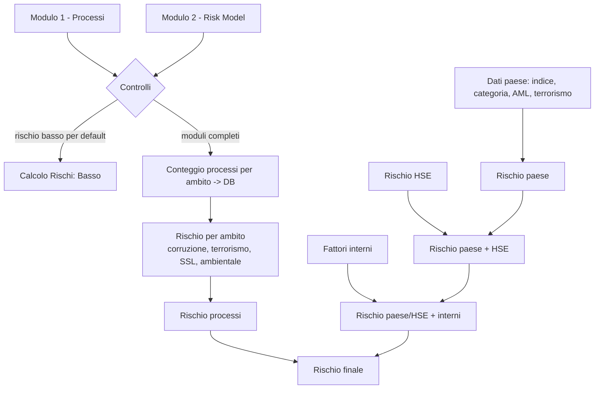

# Clusterizzazione del rischio delle società di un gruppo (VBA / Excel)

Macro VBA che assegna a ciascuna società di un gruppo una classe di rischio **Basso / Medio / Alto**, a partire da due questionari compilati in Excel (processi svolti ed esternalizzati) e da indicatori di rischio paese e HSE.

> ⚠️ Questo repository contiene **solo codice**. Non include dati reali: nessun nome di società o di cliente, nessun risultato di valutazione. I nomi delle società vengono letti dalle celle dei moduli al momento dell'esecuzione.

---

## Cosa fa

La macro `Salva`:

1. **controlla** che il nome della società sia presente in entrambi i moduli, coincida e sia riconosciuto nell'elenco società-paese;
2. gestisce il caso di **rischio basso per default** (la società viene registrata direttamente come "Basso");
3. verifica che i moduli siano **completi** e, se la società è già nel database, chiede se **sovrascrivere**;
4. conta i processi per **quattro ambiti** (corruzione, terrorismo, salute e sicurezza sul lavoro, ambientale) e registra i conteggi nel foglio `DB`;
5. scrive nel foglio `Calcolo Rischi` le **formule** che producono il rischio finale;
6. **svuota i moduli** per la società successiva.



---

## Contenuto del repository

| File | Descrizione |
|---|---|
| `RischioSocieta.bas` | Modulo VBA con la macro `Salva` e le funzioni di supporto |
| `README.md` | Questo documento |

---

## Struttura attesa della cartella di lavoro

I nomi dei fogli sono costanti all'inizio del modulo.

| Foglio | Contenuto |
|---|---|
| `Modulo 1 - Processi` | Questionario sui processi: nome società in `C2`; una riga per processo (righe 5–36); colonna `C` e colonna `D` segnate con `a` |
| `Modulo 2 - Risk Model` | Nome società in `E2`; in `E61` l'esito della verifica ("SI" = rischio basso per default, oppure il messaggio di sezioni incomplete) |
| `Associazione Soc.-Paese` | Elenco delle società (colonna A) con il rispettivo paese |
| `Associazione processi-ambiti` | Per ogni processo (righe 5–36), l'associazione ai quattro ambiti nelle colonne `B`–`E` |
| `Rischio Fattori interni` | Paese della società in `C2` e risposte sui fattori di rischio interni |
| `DB` | Una riga per società: conteggi per ambito (colonne `B`–`I`) e paese (`J`) |
| `Calcolo Rischi` | Una riga per società, con le formule dei rischi (colonne `B`–`P`) |
| `Parametri` | Valori di riferimento per ambito (riga 4) e per l'indice paese (`C8`) |
| `CPI`, `SACE`, `AML2017_FINAL`, `TERR2016_FINAL` | Indicatori per paese |
| `Rischio HSE` | Rischio HSE per società |

I fogli `DB` e `Calcolo Rischi` sono **allineati riga per riga**: alcune formule leggono il DB sulla stessa riga, quindi la macro scrive sempre la società nella stessa riga di entrambi.

---

## Logica di calcolo

| Passo | Colonna | Regola |
|---|---|---|
| Rischio per ambito | `B`–`E` | punteggio = processi svolti − 0,75 × processi esternalizzati. Confronto con il valore di riferimento dell'ambito: sotto l'80 % = **Basso**, sopra il 120 % = **Alto**, altrimenti **Medio** |
| Rischio processi | `F` | punti per ambito: Basso 0,33, Medio 0,66, Alto 1. Somma ≤ 1,65 = **Basso**, ≤ 2,98 = **Medio**, oltre = **Alto** |
| Indice paese | `G` | indice del paese / valore di riferimento: < 0,68 = **Alto**, < 1,32 = **Medio**, altrimenti **Basso** |
| Categoria, AML, terrorismo | `H`–`J` | lookup per paese nei fogli dedicati |
| Rischio paese | `K` | almeno due "alto" tra `G`–`J` = alto (salvo due "basso" = medio); più di due "basso" = basso; altrimenti medio |
| Rischio HSE | `L` | lookup per società |
| Paese + HSE | `M` | Basso se paese basso e HSE assente; Alto se paese alto o HSE significativo; altrimenti Medio |
| Fattori interni | `N` | Alto se risultano segnate due specifiche domande; Basso se nessuna delle domande del gruppo è segnata; altrimenti Medio. Salvato come valore |
| Sintesi esterna | `O` | Alto se `M` e `N` sono alti; Basso se almeno uno è basso; altrimenti Medio |
| **Rischio finale** | `P` | Alto se `F` e `O` sono alti; Medio se almeno uno è alto o entrambi medi; altrimenti Basso |

Pesi e soglie sono costanti documentate in testa al modulo (`PESO_ESTERNALIZZATI`, `SOGLIA_BASSA`, `SOGLIA_ALTA`, …): si modificano in un solo punto.

---

## Come usarla

1. Salva la cartella di lavoro come `.xlsm` e crea i fogli descritti sopra.
2. `Alt + F11` → `File → Importa file…` → seleziona `RischioSocieta.bas`.
3. Compila `Modulo 1` e `Modulo 2` per una società.
4. Esegui `Salva` (`Alt + F8`, oppure assegnala a un pulsante).
5. Leggi il risultato nella colonna `P` di `Calcolo Rischi`.

---

## Scelte tecniche

- Un'unica routine (`ContaProcessi`) sostituisce otto cicli quasi identici; `FormulaAmbito` genera le quattro formule per ambito.
- Le formule sono scritte in **R1C1** con `.FormulaR1C1`; i parametri numerici sono testo (`"0.75"`) perché la sintassi richiede il punto decimale anche con Excel in italiano.
- Il nome della società viene cercato con corrispondenza **esatta** (`Match` con tipo 0 e `Find` con `xlWhole`): non si eliminano righe di società con nomi simili.
- Le lettere accentate dei messaggi sono scritte con `ChrW()`: il file `.bas` resta in ASCII puro.
- Se la società è "a rischio basso per default" e l'utente risponde **No**, i moduli non vengono svuotati.

---

## Limiti noti

- Per i processi **esternalizzati** (colonna `D`) il confronto con l'associazione processi-ambiti usa il valore della colonna `C` dello stesso processo, come nella logica di partenza: va verificato che sia coerente con la metodologia adottata.
- Il foglio `Rischio Fattori interni` deve riferirsi alla società in compilazione: il valore del paese e il rischio `N` sono salvati al momento del salvataggio.
- Gli indicatori per paese (`CPI`, `SACE`, AML, terrorismo) vanno aggiornati periodicamente.
- I nomi con caratteri jolly (`?`, `*`, `~`) possono dare esiti imprevisti nella ricerca.

---

## Privacy

- Non caricare su GitHub la cartella di lavoro `.xlsm`, né elenchi di società, paesi o risultati.
- Per un esempio funzionante usare solo società e dati inventati.
- `.gitignore` consigliato:

```gitignore
*.xlsx
*.xlsm
*.xls
*.csv
~$*
```

## Requisiti

- Microsoft Excel per Windows con macro abilitate

## Licenza

Scegli una licenza (ad esempio MIT) e aggiungi un file `LICENSE`.
