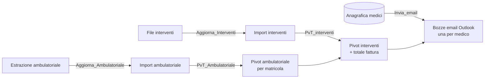

# Fatturato extramoenia per medico (VBA / Excel)

Macro VBA per calcolare il **fatturato mensile da comunicare ai medici in extramoenia**, distinguendo tra **attività di ricovero (interventi)** e **attività ambulatoriale**, e per predisporre in Outlook una **bozza di email per ciascun medico** con il dettaglio degli importi.

> ⚠️ Questo repository contiene **solo codice**. Non include dati reali: niente anagrafiche, importi, nominativi di medici o pazienti, indirizzi email. I dati dell'ente nel testo dell'email sono **segnaposto**.

---

## Cosa fa

Ogni mese arrivano due estrazioni: gli **interventi** (ricovero) e l'**ambulatoriale**. La procedura:

1. aggiorna le due query Power Query che leggono i file delle estrazioni;
2. somma l'importo ambulatoriale per matricola;
3. costruisce una pivot degli interventi con filtro sul medico e, accanto, calcola il **totale da fatturare** (ambulatoriale + interventi);
4. per ogni medico in anagrafica, filtra la pivot, ne copia la tabella come immagine e apre in Outlook un messaggio con il testo e le istruzioni di fatturazione.



---

## Contenuto del repository

| File | Descrizione |
|---|---|
| `Extramoenia.bas` | Modulo VBA con le cinque macro |
| `README.md` | Questo documento |

## Le cinque macro (in ordine di esecuzione)

| # | Macro | Funzione |
|---|---|---|
| 1 | `Aggiorna_Interventi` | Chiede conferma e aggiorna la query Power Query degli interventi |
| 2 | `Aggiorna_Ambulatoriale` | Chiede conferma e aggiorna la query Power Query dell'ambulatoriale |
| 3 | `PvT_Ambulatoriale` | Ricrea la pivot dell'ambulatoriale: somma importo per matricola |
| 4 | `PvT_interventi` | Ricrea la pivot degli interventi e aggiunge *Fatturato ambulatoriale* e *Totale fattura* |
| 5 | `Invia_email` | Crea una bozza email per ogni medico con testo e tabella degli importi |

Le pivot (`PvT …`) vengono **cancellate e ricreate a ogni esecuzione**: non modificarle a mano.

---

## Struttura attesa della cartella di lavoro

I nomi di fogli, pivot, query e campi sono costanti all'inizio del modulo: si adattano in un solo punto.

| Foglio | Contenuto |
|---|---|
| `Anagrafica Medici` | Intestazioni in riga 1. Colonna **A** matricola, **B** cognome, **F** indirizzo email |
| `Import interventi` | Caricato da Power Query: `MATRICOLA`, `Nominativo`, `Data Intervento`, `Nosologico`, `IMPORTO` (colonne A–E) |
| `Import ambulatoriale` | Caricato da Power Query: due colonne, matricola (`Column4`) e importo (`Column8`) |
| `PvT interventi`, `PvT ambulatoriale` | Creati dalle macro |

Le **query Power Query** (`Interventi`, `Ambulatoriale`) leggono file Excel esterni salvati in una cartella e **non fanno parte del codice VBA**: vanno create nella propria cartella di lavoro. La **matricola** deve coincidere nei tre elenchi (anagrafica, interventi, ambulatoriale).

Esempio fittizio di ciò che il medico vede nell'email (pivot interventi, filtrata sulla sua matricola):

| MATRICOLA | 1001 | | | |
|---|---|---|---|---|
| **Nominativo / Nosologico** | **Somma di IMPORTO** | **Fatturato ambulatoriale** | | **Totale fattura** |
| ROSSI MARIO | 3.000,00 | 800,00 | | 3.800,00 |
| &nbsp;&nbsp;&nbsp;2025000123 | 1.800,00 | | | |
| &nbsp;&nbsp;&nbsp;2025000456 | 1.200,00 | | | |

---

## Come usarla

1. Salva la cartella di lavoro come `.xlsm` e crea i fogli e le query descritti sopra.
2. `Alt + F11` → `File → Importa file…` → seleziona `Extramoenia.bas`.
3. **Sostituisci i segnaposto `ENTE_*`** in cima al modulo con i dati reali dell'ente (denominazione, P. IVA, codice SDI, PEC, sede).
4. Copia i nuovi file di estrazione nella cartella delle query, con i nomi attesi.
5. Esegui le macro 1–5 con `Alt + F8` o da pulsanti. Dopo le macro 3 e 4 compare un promemoria: **controlla i dati prima di proseguire**.
6. In Outlook controlla ogni bozza e **invia manualmente**.

### Dettagli sull'email

- Il corpo contiene il testo con le istruzioni di fatturazione elettronica (codice destinatario, PEC, dati anagrafici, sede, nota sullo split payment).
- L'area `A1:G20` della pivot interventi viene copiata come **immagine** e incollata in fondo al messaggio, tramite l'editor Word di Outlook.
- I messaggi vengono **solo aperti** (`.Display`): la macro non spedisce nulla.
- Si saltano i medici senza matricola o senza email in anagrafica.

---

## Scelte tecniche

- Le due macro di aggiornamento condividono un'unica routine (`AggiornaQuery`): cambiano solo query e messaggio.
- Le formule sono scritte con `.Formula` (sintassi inglese), quindi funzionano con Excel in qualunque lingua.
- Le lettere accentate nel testo dell'email sono scritte con `ChrW()`: il file `.bas` resta in ASCII puro e si importa senza problemi di codifica.
- Nessun uso di `Select`/`ActiveSheet` per costruire le pivot: si lavora su oggetti `Worksheet`/`PivotTable`.
- Dopo l'aggiornamento di una query la macro attende il termine delle query asincrone prima di segnalare il completamento.

---

## Limiti noti

- Un medico **senza interventi** nel periodo non compare nella pivot interventi: viene saltato e **non riceve l'email**, anche se ha attività ambulatoriale.
- Il totale da fatturare dipende dalla corrispondenza delle matricole: matricole mancanti o scritte in modo diverso tra i fogli danno importi a zero.
- Richiede **Outlook desktop** (Windows) e una versione recente di Excel: la creazione delle pivot usa `Version:=8`, tipico di Microsoft 365.
- L'immagine della pivot è una copia dello schermo: il foglio `PvT interventi` deve essere visibile durante l'esecuzione.

---

## Privacy

- Non caricare mai su GitHub la cartella di lavoro `.xlsm`/`.xlsx`, né le estrazioni o l'anagrafica. Un file Excel conserva anche dati nascosti: cache delle pivot, percorsi locali, query Power Query, metadati.
- Per un esempio funzionante, usare solo dati inventati.
- `.gitignore` consigliato:

```gitignore
*.xlsx
*.xlsm
*.xls
*.csv
~$*
```

## Requisiti

- Microsoft Excel per Windows con macro abilitate (Power Query incluso)
- Microsoft Outlook desktop
