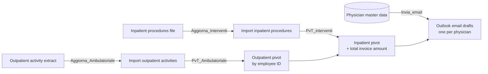

# Extramoenia Revenue by Physician (VBA / Excel)

VBA macro to calculate the **monthly revenue to be reported to physicians performing extramoenia activities**, distinguishing between **inpatient activities (surgical procedures)** and **outpatient activities**, and to prepare an **email draft for each physician in Outlook**, including a breakdown of the amounts.

> ⚠️ This repository contains **code only**. It does not include any real data: no personal records, amounts, physician or patient names, or email addresses. The organization's details in the email body are **placeholders**.

---

## What It Does

Each month, two data extracts are received: **surgical procedures** (inpatient activities) and **outpatient activities**. The procedure:

1. Refreshes the two Power Query queries that read the extraction files;
2. Calculates the total outpatient amount for each employee ID;
3. Creates a pivot table of inpatient procedures, filtered by physician, and calculates the **total amount to be invoiced** (outpatient + inpatient activities);
4. For each physician listed in the master data, filters the pivot table, copies its contents as an image, and opens an Outlook message containing the relevant information and invoicing instructions.



---

## Repository Contents

| File | Description |
|---|---|
| `Extramoenia.bas` | VBA module containing the five macros |
| `README.md` | This document |

## The Five Macros (Execution Order)

| # | Macro | Function |
|---|---|---|
| 1 | `Aggiorna_Interventi` | Requests confirmation and refreshes the inpatient procedures Power Query |
| 2 | `Aggiorna_Ambulatoriale` | Requests confirmation and refreshes the outpatient activities Power Query |
| 3 | `PvT_Ambulatoriale` | Recreates the outpatient pivot table: total amount by employee ID |
| 4 | `PvT_interventi` | Recreates the inpatient procedures pivot table and adds *Outpatient Revenue* and *Total Invoice Amount* |
| 5 | `Invia_email` | Creates an email draft for each physician, including the message and the amounts table |

The pivot tables (`PvT …`) are **deleted and recreated each time the macros run**. Do not modify them manually.

---

## Expected Workbook Structure

Sheet names, pivot table names, query names, and field names are defined as constants at the beginning of the VBA module, so they can be adapted in one place.

| Worksheet | Contents |
|---|---|
| `Anagrafica Medici` | Headers in row 1. Column **A**: employee ID; **B**: surname; **F**: email address |
| `Import interventi` | Loaded through Power Query: `MATRICOLA`, `Nominativo`, `Data Intervento`, `Nosologico`, `IMPORTO` (columns A–E) |
| `Import ambulatoriale` | Loaded through Power Query: two columns, employee ID (`Column4`) and amount (`Column8`) |
| `PvT interventi`, `PvT ambulatoriale` | Created by the macros |

The **Power Query queries** (`Interventi`, `Ambulatoriale`) read external Excel files stored in a folder and **are not included in the VBA code**. They must be created separately in the workbook.

The **employee ID** must match across all three datasets (physician master data, inpatient procedures, and outpatient activities).

Example of what a physician sees in the email (inpatient pivot table filtered by their employee ID):

| MATRICOLA | 1001 | | | |
|---|---|---|---|---|
| **Nominativo / Nosologico** | **Somma di IMPORTO** | **Fatturato ambulatoriale** | | **Totale fattura** |
| ROSSI MARIO | 3,000.00 | 800.00 | | 3,800.00 |
| &nbsp;&nbsp;&nbsp;2025000123 | 1,800.00 | | | |
| &nbsp;&nbsp;&nbsp;2025000456 | 1,200.00 | | | |

---

## How to Use It

1. Save the workbook as an `.xlsm` file and create the worksheets and queries described above.
2. Press `Alt + F11` → `File → Import File…` → select `Extramoenia.bas`.
3. **Replace the `ENTE_*` placeholders** at the beginning of the module with the organization's actual details (legal name, VAT number, SDI recipient code, certified email address (PEC), and registered office).
4. Copy the new extraction files into the folder used by the queries, using the expected file names.
5. Run macros 1–5 using `Alt + F8` or dedicated buttons. After macros 3 and 4, a reminder appears: **check the data before proceeding**.
6. Review each email draft in Outlook and **send it manually**.

### Email Details

- The email body contains invoicing instructions, including electronic invoicing details (recipient code, PEC address, company registration details, registered office, and a note about split payment).
- The range `A1:G20` of the inpatient procedures pivot table is copied as an **image** and pasted at the end of the message using the Outlook Word editor.
- Messages are **only displayed** (`.Display`): the macro does not send any emails.
- Physicians without an employee ID or email address in the master data are skipped.

---

## Technical Design

- The two refresh macros share a single routine (`AggiornaQuery`): only the query name and message differ.
- Formulas are written using `.Formula` (English syntax), making them compatible with Excel regardless of its display language.
- Accented characters in the email body are encoded using `ChrW()`: the `.bas` file remains pure ASCII and can be imported without character-encoding issues.
- No use of `Select` or `ActiveSheet` when creating pivot tables: the code works directly with `Worksheet` and `PivotTable` objects.
- After refreshing a query, the macro waits for asynchronous queries to finish before reporting completion.

---

## Known Limitations

- A physician **with no inpatient procedures** during the reporting period will not appear in the inpatient pivot table. As a result, that physician is skipped and **will not receive an email**, even if they have outpatient activities.
- The total amount to be invoiced depends on matching employee IDs. Missing IDs or IDs formatted differently across worksheets may result in zero amounts.
- Requires **Outlook desktop for Windows** and a recent version of Excel: pivot table creation uses `Version:=8`, typically associated with Microsoft 365.
- The pivot table image is captured from the worksheet display: the `PvT interventi` worksheet must be visible while the macro is running.

---

## Privacy

- Never upload the `.xlsm`/`.xlsx` workbook, extraction files, or physician master data to GitHub. Excel files may also retain hidden information, such as pivot table caches, local file paths, Power Query definitions, and metadata.
- Use fictional data only when creating working examples.
- Recommended `.gitignore`:

```gitignore
*.xlsx
*.xlsm
*.xls
*.csv
~$*
```

## Requirements

- Microsoft Excel for Windows with macros enabled (including Power Query)
- Microsoft Outlook desktop
