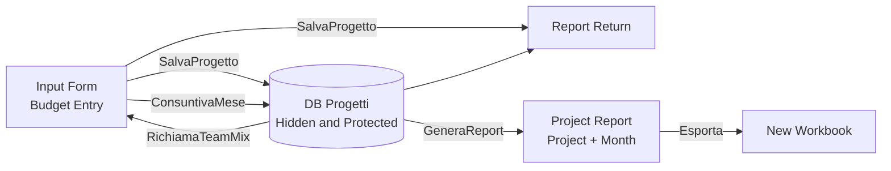

# Project Budget Monitoring (VBA / Excel)

An Excel-based tool for monitoring projects from a **budget perspective**. It starts with the team mix and the monthly planned working days, records actual working days month by month, and calculates the **return** (contract value ÷ fees) both at budget and actual levels, including the corresponding variance.

> ⚠️ This repository contains **code only**. It does not include project data, hourly cost rates, passwords, or client names. Cost rates are stored in a separate worksheet (`Parametri`), which is not published; the worksheet protection password and service line names are **placeholders**.

---

## What It Does

1. **Budget**: The user completes the input form (project, fiscal year, service line by role, monthly working days, and contract value). `SalvaProgetto` writes 96 rows to the database (12 months × 8 roles), plus one row in the summary.
2. **Actuals**: Each month, `RichiamaTeamMix` retrieves the project's team mix. Actual working days are entered and `ConsuntivaMese` records them. Actual fees are recalculated using the database formulas.
3. **Monitoring**: The `Report Return` worksheet displays the budget and actual return, variance, and revenue for each project.
4. **Reporting**: `GeneraReport` creates a project-specific snapshot worksheet showing return, monthly trends, and actuals by role. `Esporta` exports it to a new workbook.



---

## Repository Contents

| File | Description |
|---|---|
| `MonitoraggioProgetti.bas` | VBA module containing all macros |
| `README.md` | This document |

## Macros

| Macro | Function |
|---|---|
| `SalvaProgetto` | Saves a new project's budget to the database and adds a row to `Report Return` |
| `RichiamaTeamMix` | Retrieves the service line assigned to each role of an existing project into the input form |
| `ConsuntivaMese` | Records the actual working days for the selected month (with confirmation if the month has already been recorded) |
| `EliminaProgetto` | Deletes a project from the database and `Report Return` |
| `SvuotaDB` | Clears the database and `Report Return` |
| `GeneraReport` | Creates the project's report worksheet, including an **X** button to delete it |
| `Esporta` | Copies the active worksheet into a new workbook, removing the logo and replacing formulas with their calculated values |
| `CancellaFoglio` | Deletes a report worksheet (template worksheets are excluded) |

The macros that modify data **temporarily unprotect and then restore worksheet and workbook protection**, including when an error occurs. The database is returned to its hidden and protected state.

---

## Expected Workbook Structure

Worksheet names, cell references, and row positions are defined as constants at the beginning of the VBA module.

| Worksheet | Contents |
|---|---|
| `Compilazione budget` | Input form: project `B2`, fiscal year `B3`, month to be recorded `F2`, contract value `G19`. Roles in `A7:A14`, service lines in `B7:B14`. From month 1 (columns `E`–`F`) to month 12 (`AA`–`AB`): working days and fees by role |
| `DB Progetti` | Database (hidden and protected): one row for each project × month × role |
| `Report Return` | Project summary: headers in row 8, data starting from row 9 |
| `Parametri` | **Not included.** Hourly cost rates: key `FY & LoS & Ruolo` in column `A`, value in column `E`; role-to-value mapping for the special service line in `D26:F33` |

### Database Columns

| Column | Contents | Column | Contents |
|---|---|---|---|
| `A` | FY | `J` | Actual working days |
| `B` | Project name | `L` | Month number |
| `C` | Role | `M` | Actual statutory fees |
| `D` | Service Line (LoS) | `N` | Actual management fees |
| `E` | Month ("Mese 1"…"Mese 12") | `O` | Report key (project + month) |
| `F` | Budgeted working days | `P`, `Q` | Actual role and LoS |
| `G` | Budgeted statutory fees | `R` | Report key 2 (project + role + LoS) |
| `H` | Budgeted management fees | `S` | Report key 3 (project + recorded month) |
| `I` | Contract value | | |

### Key Calculations

- **Actual statutory fees** = actual working days × 8 hours × hourly rate (retrieved using the key `FY & LoS & Ruolo`).
- **Management fees**: for the special service line (`LOS_B`), the hourly rate is retrieved from the role-based table; for all other service lines, it is the same as the statutory rate.
- **Return** = contract value ÷ total fees (budget or actual, statutory or management). **Variance (Delta)** = budget return − actual return.

---

## How to Use It

1. Save the workbook as an `.xlsm` file and create the worksheets described above, populating the `Parametri` worksheet with your own values.
2. Press `Alt + F11` → `File → Import File…` → select `MonitoraggioProgetti.bas`.
3. At the beginning of the module, **replace `PWD`** with the password used to protect the workbook structure, `DB Progetti`, and `Report Return`. Also replace `LOS_A` / `LOS_B` with your own service line names.
4. Assign the macros to the buttons on the input form.
5. Monthly workflow: `RichiamaTeamMix` → enter actual working days in the relevant month's column and specify the month in `F2` → `ConsuntivaMese` → `GeneraReport`.

---

## Technical Design

- The twelve separate monthly macros and repeated monthly code blocks have been replaced with loops, using a calculated month column (`ColonnaGiornate`).
- No use of `Select` or `ActiveCell`: the code works directly with worksheets and cells, without depending on the current selection.
- Projects can be deleted or updated without temporary columns or filters: rows are identified by project name and block.
- Formulas are written using `.Formula` (English syntax), making them compatible with any Excel language version.
- Accented characters in messages are encoded using `ChrW()`: the `.bas` file remains pure ASCII.
- Report worksheets are renamed using valid worksheet names (maximum 31 characters, with no prohibited characters).

---

## Known Limitations

- Project names must be **unique**; each project's rows must remain **contiguous** (12 blocks of 8 rows), as generated by `SalvaProgetto`.
- The "project + month" key is created by concatenating text strings. Project names ending in numbers may cause ambiguity (for example, "Prog1" + 2 and "Prog" + 12).
- The database is read up to row 5,000 when calculating the reference month for the report (`ULTIMA_RIGA_DB`).
- Requires Excel 2013 or later (`NUMBERVALUE`) and macros enabled.
- The `Parametri` worksheet and the input form contain formulas that are not included in the VBA code and must be recreated separately.

---

## Privacy and Confidentiality

- Do not upload the `.xlsm` workbook to GitHub: it contains project data, the cost-rate worksheet (even if hidden), local file paths, and metadata.
- Excel password protection **is not a security measure** and should not be relied upon to protect confidential data.
- Use fictional projects and values only when creating working examples.
- Recommended `.gitignore`:

```gitignore
*.xlsx
*.xlsm
*.xls
*.csv
~$*
```

## License

Choose a license (e.g. MIT) and add a `LICENSE` file.
