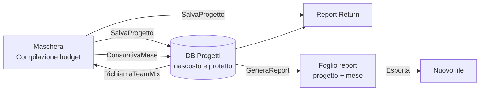

# Monitoraggio del budget dei progetti (VBA / Excel)

Strumento in Excel per seguire i progetti in termini di **budget**: si parte dal team mix e dalle giornate pianificate per mese, si registrano mese dopo mese le giornate effettive e si calcola il **return** (valore del contratto ÷ onorari) a budget e a consuntivo, con il relativo scostamento.

> ⚠️ Questo repository contiene **solo codice**. Non include dati di progetto, valori orari di costo, password o nomi di clienti. I valori di costo stanno in un foglio separato (`Parametri`) non pubblicato; la password di protezione e i nomi delle linee di servizio sono **segnaposto**.

---

## Cosa fa

1. **Budget**: si compila la maschera (progetto, fiscal year, linea di servizio per ruolo, giornate per mese, valore del contratto) e `SalvaProgetto` scrive nel database 96 righe (12 mesi × 8 ruoli) più una riga nel riepilogo.
2. **Consuntivo**: ogni mese `RichiamaTeamMix` riporta il team del progetto, si inseriscono le giornate effettive e `ConsuntivaMese` le registra. Gli onorari a consuntivo si ricalcolano con le formule del database.
3. **Controllo**: il foglio `Report Return` mostra per ogni progetto return a budget e a consuntivo, delta e produzione.
4. **Report**: `GeneraReport` crea per un progetto un foglio "fotografia" con return, andamento mensile e consuntivo per ruolo; `Esporta` lo porta in un nuovo file.



---

## Contenuto del repository

| File | Descrizione |
|---|---|
| `MonitoraggioProgetti.bas` | Modulo VBA con tutte le macro |
| `README.md` | Questo documento |

## Macro

| Macro | Funzione |
|---|---|
| `SalvaProgetto` | Salva il budget di un nuovo progetto nel DB e aggiunge la riga nel `Report Return` |
| `RichiamaTeamMix` | Richiama nella maschera la linea di servizio di ogni ruolo di un progetto esistente |
| `ConsuntivaMese` | Registra le giornate effettive del mese indicato (con conferma se già consuntivato) |
| `EliminaProgetto` | Elimina un progetto da DB e `Report Return` |
| `SvuotaDB` | Svuota DB e `Report Return` |
| `GeneraReport` | Crea il foglio di report del progetto, con pulsante **X** per eliminarlo |
| `Esporta` | Copia il foglio attivo in un nuovo file, senza logo e con i valori al posto delle formule |
| `CancellaFoglio` | Elimina un foglio di report (i fogli del modello sono esclusi) |

Le macro di modifica **sbloccano e ripristinano** le protezioni, anche in caso di errore: il DB torna nascosto e protetto.

---

## Struttura attesa della cartella di lavoro

I nomi di fogli, celle e righe sono costanti in testa al modulo.

| Foglio | Contenuto |
|---|---|
| `Compilazione budget` | Maschera: progetto `B2`, fiscal year `B3`, mese da consuntivare `F2`, valore del contratto `G19`. Ruoli in `A7:A14`, linea di servizio in `B7:B14`. Dal mese 1 (colonne `E`–`F`) al mese 12 (`AA`–`AB`): giornate e onorari per ruolo |
| `DB Progetti` | Database (nascosto, protetto): una riga per progetto × mese × ruolo |
| `Report Return` | Riepilogo per progetto: intestazioni in riga 8, dati dalla riga 9 |
| `Parametri` | **Non incluso.** Valori orari di costo: chiave `FY & LoS & Ruolo` in colonna `A`, valore in colonna `E`; tabella ruolo → valore per la linea di servizio speciale in `D26:F33` |

### Colonne del DB

| Col. | Contenuto | Col. | Contenuto |
|---|---|---|---|
| `A` | FY | `J` | Giornate effettive |
| `B` | Nome progetto | `L` | Numero del mese |
| `C` | Ruolo | `M` | Onorari consuntivo civilistico |
| `D` | Linea di servizio (LoS) | `N` | Onorari consuntivo gestionale |
| `E` | Mese ("Mese 1"…"Mese 12") | `O` | Chiave report (progetto + mese) |
| `F` | Giornate a budget | `P`, `Q` | Ruolo e LoS a consuntivo |
| `G` | Onorari budget civilistico | `R` | Chiave report 2 (progetto + ruolo + LoS) |
| `H` | Onorari budget gestionale | `S` | Chiave report 3 (progetto + mese consuntivato) |
| `I` | Valore del contratto | | |

### Calcoli principali

- **Onorari a consuntivo civilistico** = giornate effettive × 8 ore × valore orario (cercato con la chiave `FY & LoS & Ruolo`).
- **Onorari gestionali**: per la linea di servizio speciale (`LOS_B`) il valore orario viene dalla tabella per ruolo; per le altre coincide con quello civilistico.
- **Return** = valore del contratto ÷ somma degli onorari (budget o consuntivo, civilistico o gestionale). **Delta** = return a budget − return a consuntivo.

---

## Come usarla

1. Salva la cartella di lavoro come `.xlsm` e crea i fogli descritti sopra, con il foglio `Parametri` popolato con i propri valori.
2. `Alt + F11` → `File → Importa file…` → seleziona `MonitoraggioProgetti.bas`.
3. In testa al modulo **sostituisci `PWD`** con la password con cui proteggi struttura della cartella di lavoro, `DB Progetti` e `Report Return`, e sostituisci `LOS_A` / `LOS_B` con le proprie linee di servizio.
4. Assegna le macro ai pulsanti della maschera.
5. Flusso mensile: `RichiamaTeamMix` → inserisci le giornate effettive nella colonna del mese e il mese in `F2` → `ConsuntivaMese` → `GeneraReport`.

---

## Scelte tecniche

- Le dodici macro mensili e i blocchi ripetuti per mese sono sostituiti da cicli con la colonna del mese calcolata (`ColonnaGiornate`).
- Nessun uso di `Select`/`ActiveCell`: si lavora direttamente su fogli e celle, senza dipendere dalla selezione corrente.
- Per eliminare o aggiornare un progetto non servono colonne temporanee né filtri: le righe si individuano per nome e per blocco.
- Le formule sono scritte con `.Formula` (sintassi inglese): funzionano con qualunque lingua di Excel.
- Le lettere accentate dei messaggi sono scritte con `ChrW()`: il file `.bas` resta in ASCII puro.
- Il foglio di report si rinomina con un nome valido (massimo 31 caratteri, senza caratteri vietati).

---

## Limiti noti

- I nomi dei progetti devono essere **univoci**; le righe di un progetto devono restare **contigue** (12 blocchi da 8 righe), come le scrive `SalvaProgetto`.
- La chiave "progetto + mese" è una concatenazione di testo: nomi che terminano con cifre possono creare ambiguità (ad esempio "Prog1" + 2 e "Prog" + 12).
- Il DB si legge fino alla riga 5.000 nel calcolo del mese di riferimento del report (`ULTIMA_RIGA_DB`).
- Servono Excel 2013 o successivo (`NUMBERVALUE`) e macro abilitate.
- Il foglio `Parametri` e la maschera contengono formule non incluse nel codice VBA: vanno ricreate.

---

## Privacy e riservatezza

- Non caricare su GitHub la cartella di lavoro `.xlsm`: contiene i dati dei progetti, il foglio dei valori di costo (anche se nascosto), percorsi locali e metadati.
- Una protezione con password di Excel **non è una misura di sicurezza**: non va usata per proteggere dati riservati.
- Per un esempio funzionante usare solo progetti e valori inventati.
- `.gitignore` consigliato:

```gitignore
*.xlsx
*.xlsm
*.xls
*.csv
~$*
```

## Licenza

Scegli una licenza (ad esempio MIT) e aggiungi un file `LICENSE`.
